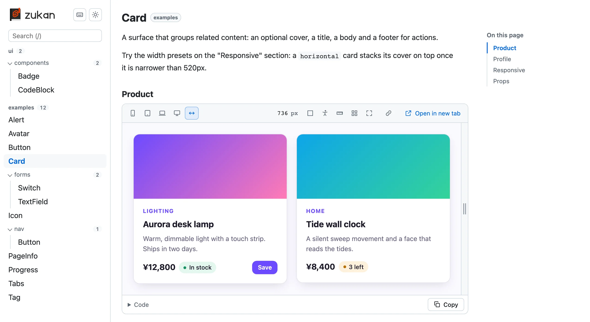
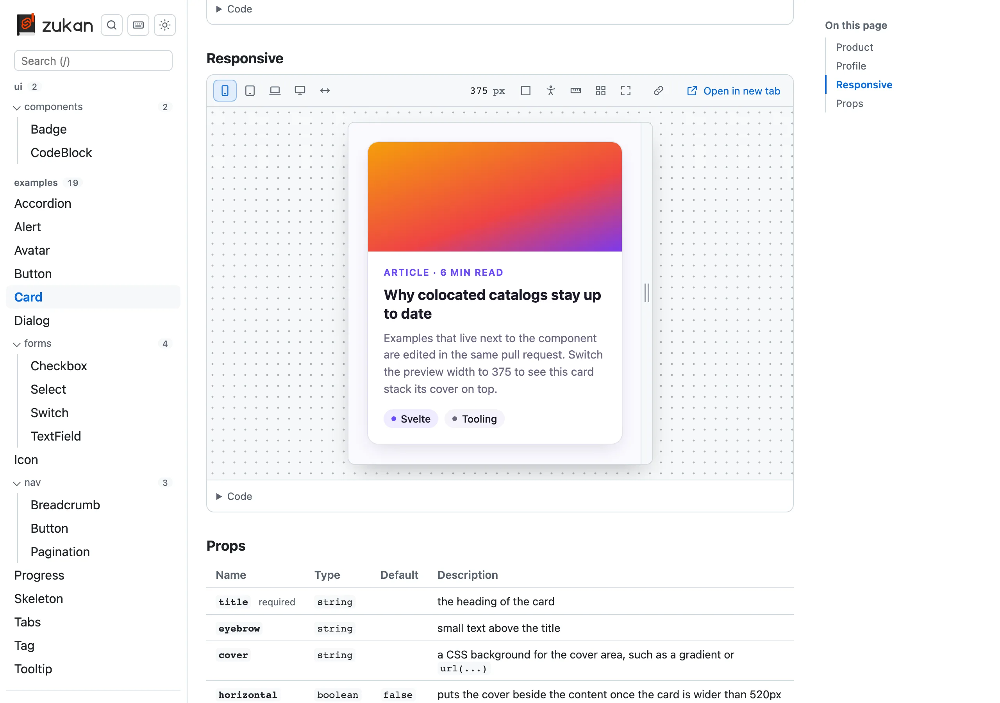
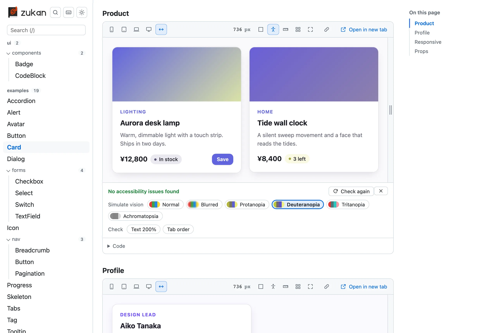

  <picture>
    <source media="(prefers-color-scheme: dark)" srcset=".github/logo-dark.svg" />
    
  </picture>

  A component catalog for Svelte. Put a catalog file next to a component and you get a list, a live preview, and a code view.

"zukan" (図鑑) is Japanese for "illustrated encyclopedia".

<picture>
  <source media="(prefers-color-scheme: dark)" srcset="docs/public/screenshots/detail-dark.webp" />
  
</picture>

- **A catalog file next to each component.** `Button.zukan.svelte` is plain Svelte: each `<Section>` becomes an example with a live preview and its code. The props table is read from `Button.svelte` itself.
- **Phone, tablet and desktop widths.** A narrow width is centered so its edges stay visible; a wider one is laid out at its real width and scaled to fit.

<picture>
  <source media="(prefers-color-scheme: dark)" srcset="docs/public/screenshots/responsive-dark.webp" />
  
</picture>

- **Accessibility checks.** axe-core runs inside the preview, outlines what it reports, and the panel can simulate blurred vision and color vision deficiencies.

<picture>
  <source media="(prefers-color-scheme: dark)" srcset="docs/public/screenshots/a11y-dark.webp" />
  
</picture>

- **One line of setup.** Add `zukan()` to your Vite plugins and open `/__zukan/`. With `build: true`, `vite build` also writes a static catalog.

> svelte-zukan is not an official Svelte project (not affiliated with or endorsed by the Svelte team). The S shape in the logo is derived from the Svelte logo.

## Links

- [Documentation](https://oekazuma.github.io/svelte-zukan/) (Support for English and Japanese)
- [Demo](https://oekazuma.github.io/svelte-zukan/demo/) ([日本語](https://oekazuma.github.io/svelte-zukan/demo/ja/))
- [Using it with AI agents](https://oekazuma.github.io/svelte-zukan/guides/ai-agents/): `catalog.json` and a skill in the package
- [Contribution Guide](CONTRIBUTING.md)

## License

[MIT](LICENSE.md)
